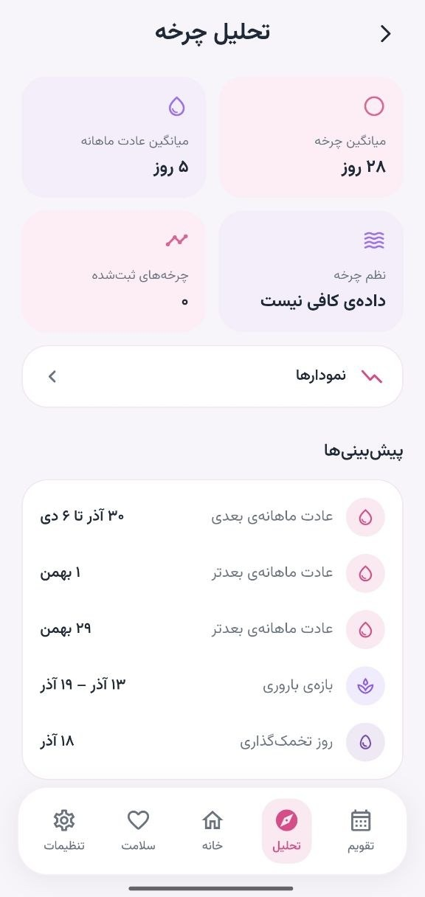
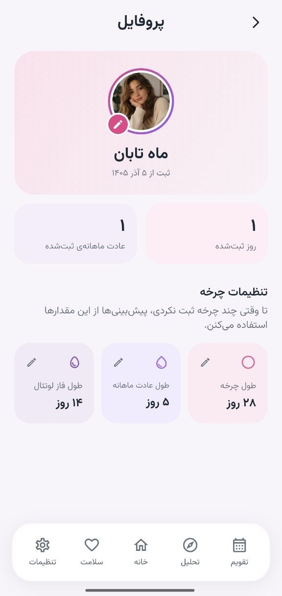
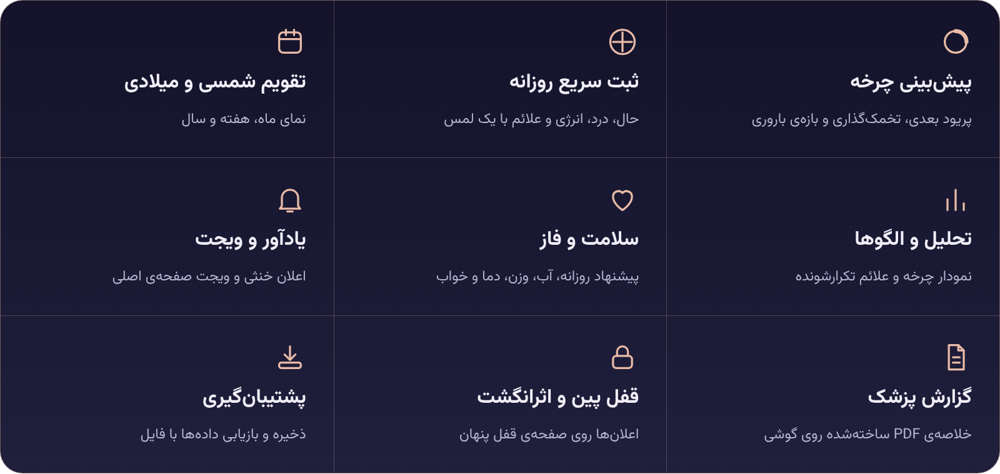

<div align="center">


<br>

**هر ماه، یه قدم جلوتر از چرخه‌ات**
**Always one step ahead of your cycle**

</div>

<div dir="rtl">

Little Moon پریود بعدی، تخمک‌گذاری و روزهای باروری‌ت رو پیش‌بینی می‌کنه
همه‌چیز فقط روی گوشی خودته: بدون حساب کاربری، بدون سرور و بدون تبلیغ

</div>

<p align="center">
Little Moon predicts your next period, ovulation and fertile days<br>
Everything stays on your phone: no account, no server, no ads
</p>

<div dir="rtl">

## دریافت · Download

</div>

<p align="center">
  <a href="https://cafebazaar.ir/app/ir.littlemoon"></a>&nbsp;
  <a href="https://myket.ir/app/ir.littlemoon"></a>&nbsp;
  <a href="https://github.com/Alion-co/littlemoon/releases/latest"></a>&nbsp;
  <a href="https://alion-co.github.io/littlemoon/"></a>
</p>

<div dir="rtl">

## نگاهی به اپ · Preview

</div>

<p align="center">
  
  
  
  
  
</p>

<div dir="rtl">

## امکانات · Features

</div>

<p align="center">
  
</p>

<div dir="rtl">

۵ زبان با پشتیبانی کامل راست‌به‌چپ (فارسی، English، العربية، Español، Türkçe) · ۸ تم روشن و تیره · تقویم شمسی و میلادی

</div>

<p align="center">
5 languages with full RTL support · 8 light and dark themes · Shamsi and Gregorian calendars
</p>

<div dir="rtl">

## حریم خصوصی · Privacy

داده‌هات فقط روی گوشی خودت می‌مونه، بدون اینترنت و بدون ردیابی

</div>

<p align="center">
Your data never leaves your phone: no internet, no tracking
</p>

<div dir="rtl">

## مشارکت · Contributing

ایده یا مشکلی داری؟ [Issue](https://github.com/Alion-co/littlemoon/issues) یا Pull Request بفرست
ترجمه‌ها فایل `.arb` توی پوشه‌ی `l10n/` هستن و برای اضافه کردن یه زبان لازم نیست کد بزنی

</div>

<p align="center">
Got an idea or found a bug? Open an <a href="https://github.com/Alion-co/littlemoon/issues">Issue</a> or a Pull Request<br>
Translations are <code>.arb</code> files in <code>l10n/</code>, no coding needed to add a language
</p>

<details>
<summary>برای توسعه‌دهنده‌ها · For developers</summary>

```bash
git clone https://github.com/Alion-co/littlemoon.git
cd littlemoon
flutter pub get
flutter run
```

Flutter 3.38+

- [Flutter](https://flutter.dev) & Dart
- [Riverpod](https://riverpod.dev) + [go_router](https://pub.dev/packages/go_router)
- [shared_preferences](https://pub.dev/packages/shared_preferences)
- [flutter_local_notifications](https://pub.dev/packages/flutter_local_notifications)
- [local_auth](https://pub.dev/packages/local_auth) + [home_widget](https://pub.dev/packages/home_widget)
- [pdf](https://pub.dev/packages/pdf) + [printing](https://pub.dev/packages/printing)

```
lib/
├── core/       # theme, l10n, routing, date & calendar utils
├── data/       # models, local storage, repositories
├── domain/     # cycle engine, reminders, notifications, backup
├── features/   # home, calendar, insights, health, profile, settings, onboarding, about
└── shared/     # shared widgets
```

</details>

<div dir="rtl">

## هشدار · Disclaimer

پیش‌بینی‌ها فقط تخمین‌ان؛ نه توصیه‌ی پزشکی‌ان و نه روش پیشگیری از بارداری

</div>

<p align="center">
Estimates only. Not medical advice and not contraception
</p>

<div dir="rtl">

## مجوز · License

رایگان برای هر استفاده‌ی **غیرتجاری**، با مجوز [PolyForm Noncommercial 1.0.0](https://polyformproject.org/licenses/noncommercial/1.0.0) (جزئیات در [`LICENSE`](LICENSE))
فونت وزیرمتن جداگانه با مجوز SIL OFL 1.1 منتشر شده

</div>

<p align="center">
Free for <b>noncommercial</b> use under <a href="https://polyformproject.org/licenses/noncommercial/1.0.0">PolyForm Noncommercial 1.0.0</a> (see <a href="LICENSE"><code>LICENSE</code></a>)<br>
Vazirmatn font is released separately under SIL OFL 1.1
</p>

<br>

<p align="center">
  <b>Designed by Alion</b>
  <br><br>
  <a href="https://instagram.com/alion.inc"></a>
</p>
