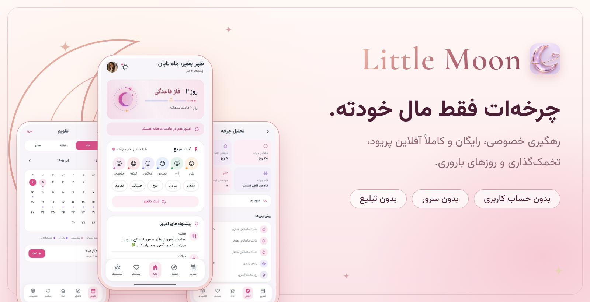
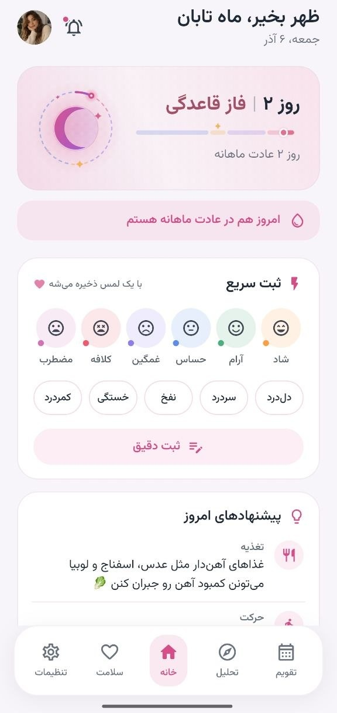
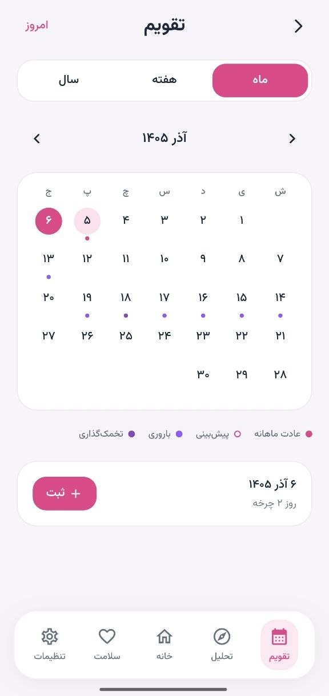
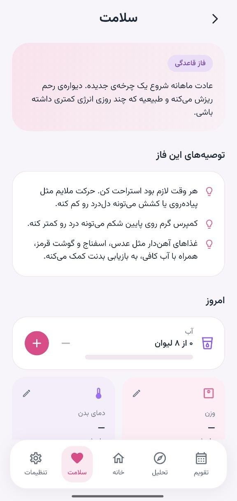
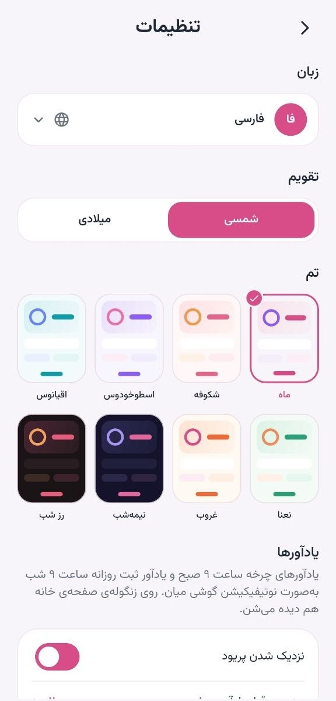

<div align="center">



</div>

<div dir="rtl">

Little Moon پریود بعدی، تخمک‌گذاری و روزهای باروری رو از روی ثبت‌های خودت پیش‌بینی می‌کنه.
همه‌ی اطلاعات فقط روی گوشی خودت می‌مونه: بدون حساب کاربری، بدون سرور و بدون تبلیغ.

## دریافت

</div>

<p align="center">
  <a href="https://cafebazaar.ir/app/ir.littlemoon"></a>
  <a href="https://myket.ir/app/ir.littlemoon"></a>
  <br>
  <a href="https://github.com/Alion-co/littlemoon/releases/latest"></a>
  <a href="https://alion-co.github.io/littlemoon/"></a>
</p>

<div dir="rtl">

## نگاهی به اپ

</div>

<p align="center">
  
  
  
  
  
  
</p>

<div dir="rtl">

## امکانات

</div>

<p align="center">
  
</p>

<div dir="rtl">

۵ زبان با پشتیبانی کامل راست‌به‌چپ (فارسی، English، العربية، Español، Türkçe) · ۸ تم روشن و تیره · تقویم شمسی و میلادی

## حریم خصوصی

همه‌ی داده‌ها روی خود دستگاه ذخیره می‌شن. اپ بدون اینترنت کار می‌کنه و هیچ ابزار تحلیل، ردیابی یا سروری نداره.
اعلان‌ها متن خنثی دارن و روی صفحه‌ی قفل پنهان می‌شن، و می‌تونی اپ رو با پین ۴ رقمی یا اثرانگشت قفل کنی.

## مشارکت

مشکل‌ها و پیشنهادها رو در [Issues](https://github.com/Alion-co/littlemoon/issues) بنویس و Pull Request هم خوش‌آمده.
ترجمه‌ها در پوشه‌ی `l10n/` و به‌صورت فایل `.arb` هستن، پس بهتر کردن یا اضافه کردن یک زبان به دست‌زدن به کد نیاز نداره.

<details>
<summary>برای توسعه‌دهنده‌ها</summary>

```bash
git clone https://github.com/Alion-co/littlemoon.git
cd littlemoon
flutter pub get
flutter run
```

به Flutter نسخه‌ی ۳.۳۸ یا بالاتر نیاز داره.

- [Flutter](https://flutter.dev) و Dart
- [Riverpod](https://riverpod.dev) برای مدیریت وضعیت و [go_router](https://pub.dev/packages/go_router) برای مسیریابی
- [shared_preferences](https://pub.dev/packages/shared_preferences) برای ذخیره‌ی محلی
- [flutter_local_notifications](https://pub.dev/packages/flutter_local_notifications) برای یادآورهای آفلاین
- [local_auth](https://pub.dev/packages/local_auth) برای اثرانگشت و [home_widget](https://pub.dev/packages/home_widget) برای ویجت اندروید
- [pdf](https://pub.dev/packages/pdf) و [printing](https://pub.dev/packages/printing) برای گزارش پزشک

```
lib/
├── core/       # تم، بومی‌سازی، مسیریابی، ابزار تاریخ و تقویم
├── data/       # مدل‌ها، ذخیره‌ی محلی، repositoryها
├── domain/     # موتور چرخه، یادآورها، اعلان‌ها، پشتیبان‌گیری
├── features/   # خانه، تقویم، تحلیل، سلامت، پروفایل، تنظیمات، شروع، درباره
└── shared/     # ویجت‌های مشترک
```

</details>

## هشدار

پیش‌بینی‌ها تخمین‌هایی از روی داده‌هایی هستن که خودت ثبت می‌کنی. Little Moon دستگاه پزشکی نیست، توصیه‌ی پزشکی نمی‌ده و نباید برای جلوگیری از بارداری استفاده بشه.

## مجوز

Little Moon برای هر کاری که **غیرتجاری** باشه آزاده: استفاده، مطالعه، تغییر و اشتراک‌گذاری، با مجوز [PolyForm Noncommercial 1.0.0](https://polyformproject.org/licenses/noncommercial/1.0.0).
فروش و هر نوع استفاده‌ی تجاری مجاز نیست (جزئیات در فایل [`LICENSE`](LICENSE)).
فونت وزیرمتن جداگانه با مجوز SIL Open Font License 1.1 منتشر شده.

</div>

<p align="center">
  <a href="https://instagram.com/alion.inc"></a>
</p>

<details>
<summary>English</summary>

**Little Moon** is a private, free and fully offline period tracker. It predicts your next period, ovulation and fertile window from what you log, and keeps everything on your phone: no account, no server, no ads. Five languages with full right-to-left support, Shamsi and Gregorian calendars, eight themes, PIN and fingerprint lock, backup files and a PDF report for your doctor.

Download from [Cafe Bazaar](https://cafebazaar.ir/app/ir.littlemoon), [Myket](https://myket.ir/app/ir.littlemoon) or the [latest release](https://github.com/Alion-co/littlemoon/releases/latest). Free for noncommercial use under the PolyForm Noncommercial License 1.0.0. Not a medical device and not a method of contraception.

</details>
