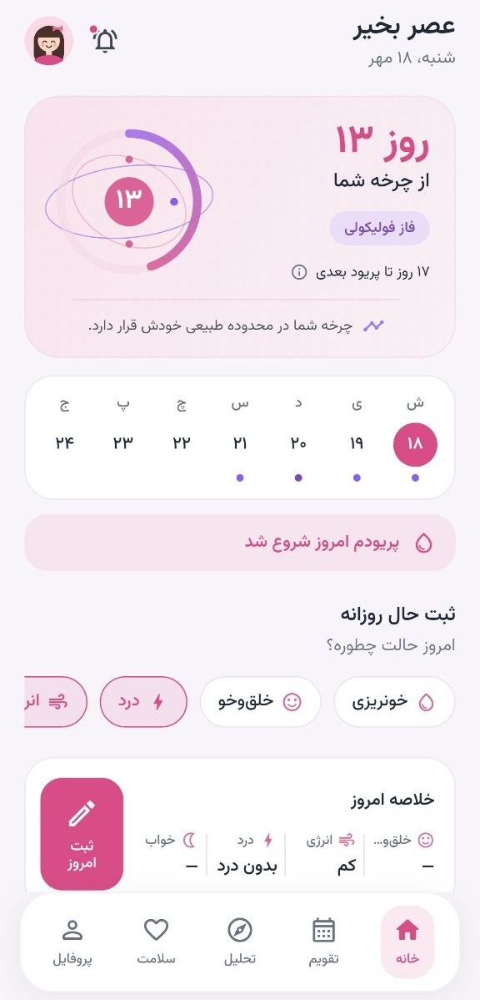
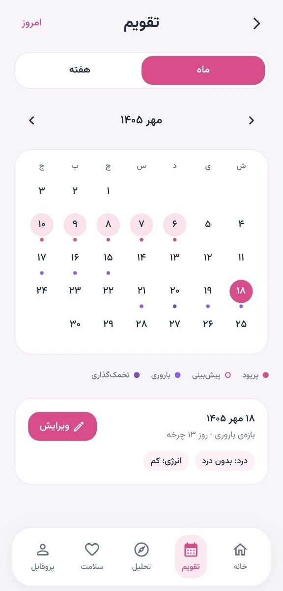
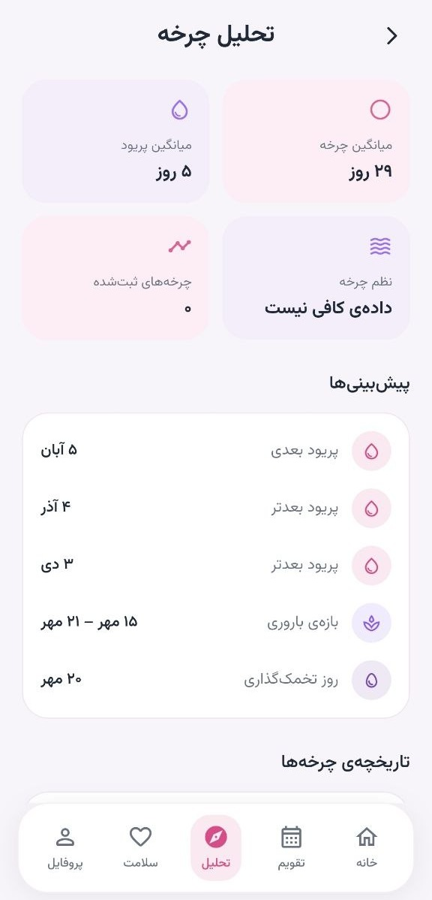
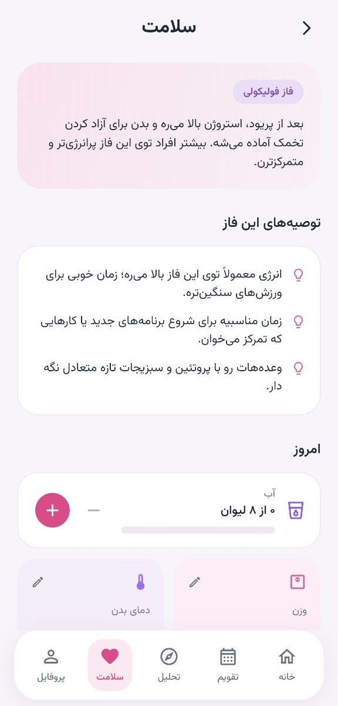
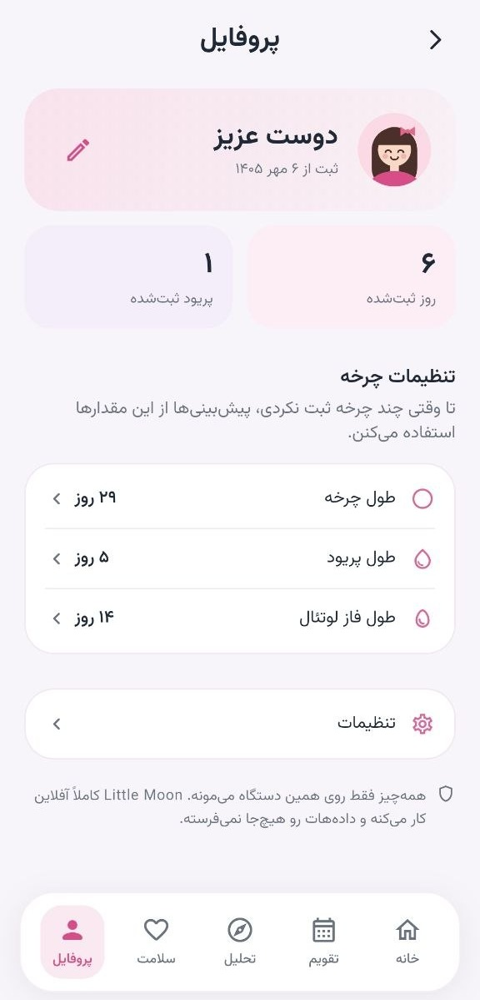
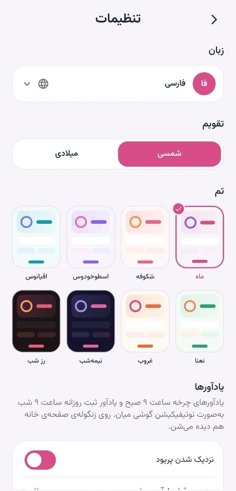

# 🌙 Little Moon

**A private, free and fully offline period tracker for girls and women.**

Little Moon predicts your cycle from what you log yourself and keeps everything on your own phone. No account, no server, no ads, and nothing is ever sent anywhere. It is free and will stay free.

## Screenshots

<p align="center">
  
  
  
</p>
<p align="center">
  
  
  
</p>

## Features

- **Cycle predictions** — next period, ovulation day and fertile window, estimated from the average of your recent logged cycles
- **Daily log** — flow, mood, pain, energy, sleep, symptoms and notes
- **Calendar** — month and week views with period, predicted, fertile and ovulation markers
- **Cycle insights** — average cycle and period length, regularity, cycle history, most frequent symptoms and mood summary
- **Health** — tips for your current phase, water, weight, body temperature and sleep tracking
- **Reminders** — local phone notifications for upcoming period, fertile window, ovulation and the daily log
- **Shamsi (Solar Hijri) and Gregorian calendars**
- **5 languages** — Persian, English, Arabic, Spanish and Turkish, with full right-to-left support
- **8 themes** — six light themes and two dark themes with a night-sky home screen
- **Avatars** — five built-in avatars for your profile
- **Backup and restore** — export all your data as plain text and restore it any time

## Privacy

All data is stored locally on the device. The app works without an internet connection and has no analytics, no tracking and no backend.

## Tech stack

- [Flutter](https://flutter.dev) and Dart
- [Riverpod](https://riverpod.dev) for state management
- [go_router](https://pub.dev/packages/go_router) for navigation
- [shared_preferences](https://pub.dev/packages/shared_preferences) for local storage
- [flutter_local_notifications](https://pub.dev/packages/flutter_local_notifications) for offline reminders

## Project structure

```
lib/
├── core/       # theme, localization, routing, date and calendar utilities
├── data/       # models, local storage, repositories
├── domain/     # cycle engine, reminders, notifications, backup
├── features/   # home, calendar, insights, health, profile, settings, onboarding, about
└── shared/     # reusable widgets
```

## Getting started

```bash
git clone https://github.com/Alion-co/littlemoon.git
cd littlemoon
flutter pub get
flutter run
```

Requires Flutter 3.38 or newer.

## Contributing

Issues and pull requests are welcome. Translations live in the `l10n/` folder as `.arb` files, so improving or adding a language does not require touching the code.

## Disclaimer

Predictions are estimates based on the data you log. Little Moon is not a medical device, does not give medical advice and must not be used as a method of contraception.

## License

Little Moon is free to use, study, modify and share for any **noncommercial** purpose under the [PolyForm Noncommercial License 1.0.0](https://polyformproject.org/licenses/noncommercial/1.0.0). Selling it or using it commercially is not allowed. See [LICENSE](LICENSE).

The bundled Vazirmatn font is licensed separately under the SIL Open Font License 1.1.

## Credits

Made by **ALION** · Instagram: [@alion.inc](https://instagram.com/alion.inc)

*Dedicated to my little moon* 🌙
